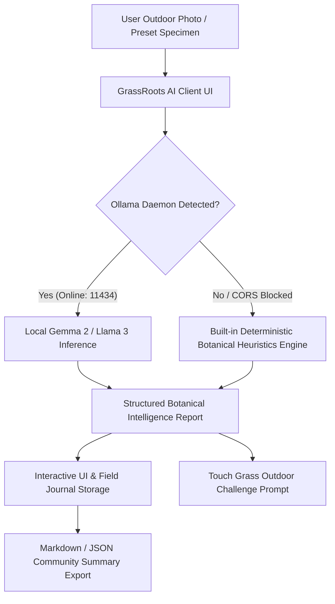

# GrassRoots AI — Local Ecosystem & Plant Explorer

[](https://dev.to/challenges)
[](https://dev.to)
[](https://ollama.com)
[](LICENSE)
[](https://vitejs.dev)

> **"Touch Grass" Edition**: An offline-first bio-monitoring web application encouraging developers and outdoor explorers to step away from screens, discover native flora and wildlife, and document biodiversity using private, local open-weight AI models.

---

## Table of Contents

- [Project Overview](#project-overview)
- [Key Features](#key-features)
- [Architecture & Tech Stack](#architecture--tech-stack)
- [Open-Weight AI Pipeline](#open-weight-ai-pipeline)
- [Zero-Breakage Offline Fallback Engine](#zero-breakage-offline-fallback-engine)
- [Getting Started](#getting-started)
- [DEV Challenge Submission Details](#dev-challenge-submission-details)
- [Contributing](#contributing)

---

## Project Overview

In an era saturated with screen-time, cognitive burnout, and remote work, **GrassRoots AI** was built for the **Hacktoberfest 2026 DEV Challenge ("Touch Grass" theme)**.

Rather than sending personal location coordinates and backyard photos to commercial cloud servers, GrassRoots AI runs **100% locally on your machine**. Powered by open-weight models (**Gemma 2** and **Llama 3** via Ollama), users can identify plants, understand local mycorrhizal and pollinator ecosystems, generate guided outdoor nature walks, and maintain an offline field journal.

---

## Key Features

### 1. Offline Plant & Wildlife Identifier

- **Interactive Scanner UI**: Upload field photos or try 1-click curated specimens (California Poppy, Maidenhair Fern, Western Honeybee, Dandelion, Stinging Nettle).
- **Botanical Intelligence**: Returns botanical binomials, family, native vs. invasive classifications, sunlight and soil needs, and foraging safety cautions.
- **"Touch Grass" Challenge**: Generates physical, sensory observation challenges for each identified specimen (e.g. observing leaf veins, feeling hydrophobic water tension, listening for pollinators).

### 2. Local Ecosystem & Trail Advisor

- **Customized Excursion Generator**: Select from 6 distinct biomes (Deciduous Forest, Riparian Stream Banks, Urban Greenbelts, Coastal Meadows, Backyard Gardens) and custom durations (30 min to Half-Day).
- **Interactive Checkpoints**: Step-by-step waypoints with target species checklists and mindful sensory prompts.
- **Gear Kit & Leave No Trace Principles**: Pre-computed packing checklists and conservation guidelines.

### 3. Community Grassroots Hub & Field Journal

- **Field Observation Logger**: Save discoveries with timestamps, location pins, and custom tags into local persistent storage.
- **Achievement Badges**: Track outdoor milestones (*Flora Scout*, *Pollinator Ally*, *Fungi Whisperer*, *Botanical Chronicler*).
- **Community Summary Exporter**: Generates formatted Markdown summaries formatted for instant posting to DEV, iNaturalist, or local park forums.

### 4. Offline Field Guide & Knowledge Base

- Comprehensive encyclopedia of native flora, pollinators, and fungi.
- Clear identification markers, ecological roles, and critical safety lookalike warnings.
- Instant 1-click bridge to test drive species in the Scanner.

---

## Architecture & Tech Stack



- **Frontend**: React 19, TypeScript, Tailwind CSS, Vite
- **Icons & Motion**: Lucide React, Framer Motion, Canvas Confetti
- **Inference Engine**: Ollama (`http://localhost:11434`), Gemma 2 (9B / 2B), Llama 3 (8B)
- **Persistence**: Browser `localStorage` (Zero tracking cookies, 100% offline-ready)

---

## Open-Weight AI Pipeline

GrassRoots AI interfaces with your local Ollama daemon via clean REST endpoints:

```bash
# Pull vision model for pixel analysis
ollama pull moondream

# Pull Gemma 2 for deep botanical taxonomy & ecological reasoning
ollama pull gemma2:9b

# Or lightweight Gemma 2 (ideal for battery-saving laptop field work)
ollama pull gemma2:2b
```

To enable web browser calls without CORS restrictions:

**PowerShell (Windows):**

```powershell
$env:OLLAMA_ORIGINS="*"
ollama serve
```

**Command Prompt (cmd.exe):**

```cmd
set OLLAMA_ORIGINS=*
ollama serve
```

**Bash / Zsh (macOS / Linux):**

```bash
export OLLAMA_ORIGINS="*"
ollama serve
```

### Zero-Breakage Offline Fallback Engine

If Ollama is not installed or offline, GrassRoots AI **never displays a broken screen**. An integrated heuristic botanical knowledge base seamlessly serves instant classifications, ensuring full usability on trails with no cellular signal.

---

## Getting Started

### Prerequisites

- Node.js (v18+)
- (Optional) [Ollama](https://ollama.com) with `gemma2:9b` or `gemma2:2b`

### Installation

```bash
# Clone the repository
git clone https://github.com/Babin123456/GrassRoots-AI.git
cd GrassRoots-AI

# Install dependencies
npm install

# Start local development server
npm run dev
```

Visit `http://localhost:5173` in your browser.

### Production Build

```bash
npm run build
```

---

## DEV Challenge Submission Details

- **Challenge**: Hacktoberfest 2026 Week 1 ("Touch Grass" Theme)
- **Target Category**: Gemma Track / Open-Source Local AI
- **Repository**: [https://github.com/Babin123456/GrassRoots-AI](https://github.com/Babin123456/GrassRoots-AI)
- **License**: MIT Permissive License

---

## Contributing

Contributions are welcome! Please feel free to open a Pull Request to expand native species entries in `src/data/fieldGuideData.ts` or add new regional trail presets.

Distributed under the **MIT License**. See `LICENSE` for details.
