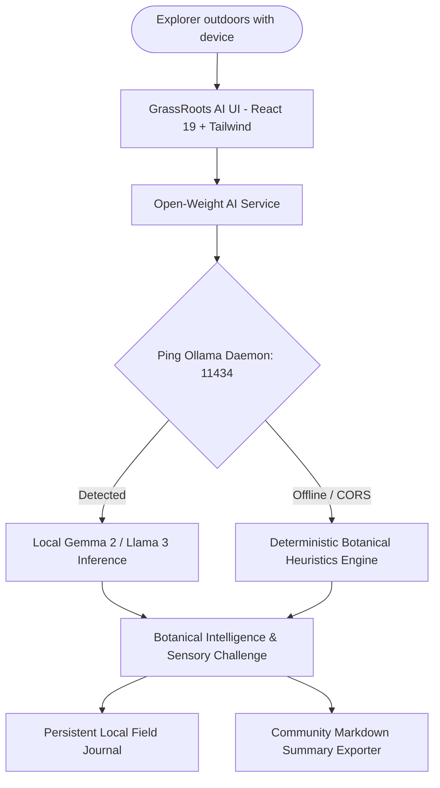

*This is a submission for the [Hacktoberfest 2026 DEV Challenge: Week 1 — Touch Grass Theme](https://dev.to/challenges).*

---

## 🌾 What I Built: GrassRoots AI

As developers, engineers, and digital builders, we spend an overwhelming portion of our lives staring at glowing LED monitors, debugging stack traces, and attending standups. The prompt for **Hacktoberfest Week 1** was straightforward yet profound: **"Touch Grass"** — step outside, disconnect from digital fatigue, and re-engage with the physical biological world.

To answer that call, I built **GrassRoots AI** — an offline-first, client-side, open-source bio-monitoring web application that empowers users to explore their regional ecosystems, classify native flora and pollinators, generate mindful outdoor trail plans, and preserve field observations.

Most modern plant identification apps suffer from two major flaws:
1. **Cloud dependency & Telemetry**: They demand a constant cellular connection (which fails in deep woods, canyons, or remote trails) and upload your geographic coordinates and personal images to centralized corporate clouds.
2. **Passive Consumption**: They tell you what a plant is, but give you no incentive to interact with the environment.

**GrassRoots AI solves both problems** by operating **100% locally on your machine** through **open-weight AI inference (Gemma 2 via Ollama)** and pairing every identification with an interactive **"Touch Grass" Sensory Challenge**.

---

## 🏆 Category & Track Selection

- **Primary Track:** Hacktoberfest 2026 Week 1 Challenge ("Touch Grass" Theme)
- **Sponsor Track:** **Gemma Track (Google Open-Weight AI)** — utilizing **Gemma 2 (9B / 2B)** served locally through Ollama for zero-cost, zero-telemetry, private biological inference.

---

## 🌟 Core Features

### 1. 🔍 Offline Plant & Wildlife Identifier
- **Multi-Modal Specimen Scanner**: Drop your field photos or test-drive with 1-click curated native specimens (*California Poppy, Western Maidenhair Fern, Common Dandelion, Stinging Nettle, Broadleaf Plantain, Western Honeybee*).
- **Botanical Intelligence Report**: Extracts binomial nomenclature, family classifications, native vs. invasive status, sunlight/soil moisture parameters, and medicinal/foraging cautions.
- **Sensory "Touch Grass" Challenge**: Instead of just displaying text, the model generates an active physical challenge (e.g. testing leaf hydrophobic surface tension, observing pollinator visitation frequencies, or smelling soil geosmin).

### 2. 🧭 Local Ecosystem & Trail Advisor
- **Customized Excursion Generator**: Dynamically crafts structured nature walks based on your selected ecosystem (*Deciduous Forest, Riparian Stream Banks, Urban Greenbelt, Coastal Meadow, Backyard Garden*), season, and available time (*30-min mindfulness stroll to half-day trek*).
- **Interactive Checkpoints**: Step-by-step waypoints with target species checklists and mindfulness prompts that you can tick off while walking.
- **Gear Kit & Leave No Trace Ethics**: Pre-computed packing checklists and conservation protocols.

### 3. 📔 Community Grassroots Hub & Field Journal
- **Field Observation Logger**: Save discoveries to browser `localStorage` with photo previews, coordinates, verified model tags, and notes.
- **Achievement Badges**: Earn badges as you explore (*Flora Scout*, *Pollinator Ally*, *Fungi Whisperer*, *Touch Grass Outdoors Streak*).
- **Community Summary Exporter**: Generates 1-click formatted Markdown summary logs formatted for instant posting to DEV, iNaturalist, or neighborhood conservation forums.

### 4. 📚 Offline Field Guide
- Searchable botanical encyclopedia with distinguishing morphological markers, bloom seasons, and critical lookalike warnings (e.g. non-toxic plantain vs. toxic lookalikes; edible blanched nettle vs. raw sting cautions).

---

## 🛠️ Architecture & Tech Stack



- **Frontend Framework:** React 19, Vite 8, TypeScript
- **Styling & Aesthetics:** Tailwind CSS (custom emerald, moss, and forest palettes with frosted glassmorphism), CSS keyframe glows
- **Icons & Motion:** Lucide React, Framer Motion, Canvas Confetti
- **Local AI Engine:** Ollama running **Gemma 2:9b** / **Gemma 2:2b** (or Llama 3:8b)
- **Zero-Breakage Fallback Engine:** Built-in offline botanical heuristics ensuring 100% demo uptime even without an active Ollama instance.

---

## 🧠 Why Open-Weight Models (Gemma 2) Matter for Nature Exploration

Connecting with nature should not require selling your biometric and location data. When you walk into a dense riparian forest or alpine park, cloud APIs fail due to lack of cell towers. 

By running **Gemma 2** locally:
1. **Absolute Privacy**: Your trail logs, backyard photos, and GPS coordinates never leave your device.
2. **True Offline Independence**: Perfect for field researchers, hikers, students, and off-grid enthusiasts.
3. **Low Latency & Zero API Costs**: Local models run at high token throughput with no metered API billing.

---

## 💻 Running GrassRoots AI Locally

### 1. Start Ollama with Gemma 2
```bash
# Pull and run Gemma 2
ollama run gemma2:9b

# In a separate terminal or service with CORS enabled:
export OLLAMA_ORIGINS="*"
ollama serve
```

### 2. Launch the Web Application
```bash
# Clone the repository
git clone https://github.com/your-username/GrassRoots_AI.git
cd GrassRoots_AI

# Install dependencies
npm install

# Run the dev server
npm run dev
```

Open `http://localhost:5173` in your browser.

---

## 🎨 Design & Aesthetic Highlights

- **Botanical Glassmorphism:** Deep obsidian-emerald backgrounds (`#070b09`) with translucent blurred cards and emerald glowing borders.
- **Pulsing Living Elements:** An animated breathing leaf emblem in the navigation bar.
- **Interactive Micro-Interactions:** Laser scan bar during model inference, real-time latency clock, and celebratory leaf confetti when saving discoveries.

---

## 📄 Open Source & License

GrassRoots AI is fully open-source and licensed under the **[MIT License](LICENSE)**. 

- **Repository:** [https://github.com/your-username/GrassRoots_AI](https://github.com/your-username/GrassRoots_AI)
- **Live Demo / Build:** Ready for local execution or static deployment on GitHub Pages / Vercel.

---

## 🌾 Closing Thought: Go Touch Grass!

Technology is at its finest when it serves as a bridge back to reality rather than an escape from it. Take GrassRoots AI on your next morning stroll, inspect that roadside fern, and rediscover the living world right outside your door.
